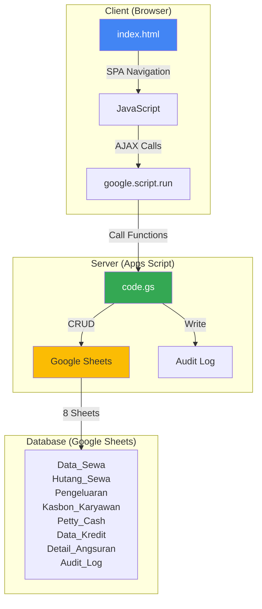

# 🏍️ Rental Management System (RMS)

> Comprehensive motorcycle rental management system built with Google Apps Script, featuring complete transaction management, financial tracking, and reporting.

[🇮🇩 Bahasa Indonesia](./README.md) | [📖 Deployment Guide](./DEPLOYMENT.md) | [🔗 Live Demo](https://your-username.github.io/RMS/)

[](https://opensource.org/licenses/MIT)
[](https://developers.google.com/apps-script)
[](https://github.com/your-username/RMS)

---

## 📋 Table of Contents

- [Overview](#-overview)
- [Key Features](#-key-features)
- [Roles & Permissions](#-roles--permissions)
- [Tech Stack](#-tech-stack)
- [Architecture](#-architecture)
- [Database Schema](#-database-schema)
- [Setup & Installation](#-setup--installation)
- [Demo](#-demo)
- [Screenshots](#-screenshots)
- [Limitations](#-limitations)
- [Changelog](#-changelog)
- [License](#-license)

---

## 🌟 Overview

**RMS (Rental Management System)** is a full-stack web application for managing motorcycle rental businesses, built entirely with Google Apps Script and Google Sheets as the database. The system provides a modern interface with role-based access control for 3 user types: Admin, Financial, and Management.

### Why Apps Script?

- ✅ **Zero Infrastructure Cost** - Free hosting by Google
- ✅ **Built-in Database** - Google Sheets as database
- ✅ **Auto Backup** - Built-in revision history via Google Drive
- ✅ **Easy Collaboration** - Share access like Google Docs
- ✅ **Mobile Responsive** - Access from phone/tablet
- ✅ **No Server Maintenance** - Fully managed by Google

### Use Cases

Ideal for:
- 🏪 Small-to-medium motorcycle rental businesses (10-100 units)
- 💼 Owners who need real-time monitoring
- 📊 Teams requiring automated financial reports
- 🔐 Multi-user with access control (cashier, finance, owner)

---

## ✨ Key Features

### 🔐 Admin Role
**Dashboard:**
- Total revenue today, this week, this month
- Available vs rented units (real-time)
- Top 5 customer debts
- Quick actions: Add rental, check debts

**Rental Transactions:**
- ➕ Add new rental (Daily/Weekly/Monthly)
- ✏️ Edit active rentals
- 🔄 Swap units (change customer's motorcycle)
- ⏰ Extend rental duration
- ✅ Complete rental + settle debts
- 🚫 Cancel rental (with reason)

**Debt Management:**
- 📋 List all rental debts
- 💰 Partial/full payment
- 🔍 Filter by status (Paid/Unpaid)
- 📄 Export to Excel

**Motorcycle Credit:**
- 📝 Input new motorcycle credit data
- 💳 Record installment payments
- 📊 Track remaining installments & due dates
- ⚠️ Notifications for upcoming installments

**Petty Cash:**
- 💵 Input petty cash capital
- ➖ Record expenses (fuel, parking, etc.)
- 📈 Real-time petty cash balance tracking
- 🔄 Capital top-up

### 💼 Financial Role
**Expenses:**
- ➕ Add expenses (Service, Fuel, Tax, etc.)
- ✏️ Edit/delete expenses
- 📊 Expense reports by category
- 📅 Filter by date

**Employee Loans:**
- 📝 Input employee loans
- 💰 Record loan payments
- 📋 Active loans list + history
- 📊 Total loans per employee

**Other Income:**
- 💵 Record non-rental income (helmet sales, etc.)
- 🏷️ Income categorization
- 📈 Track total additional income

**Financial Reports:**
- 📊 Income Statement (P&L)
- 💰 Cash Flow Report
- 📈 Revenue vs expenses charts
- 📅 Filter by period
- 📄 Export to PDF/Excel

### 📊 Management Role
**Executive Dashboard:**
- 📈 Monthly revenue chart (last 6 months)
- 💵 Total revenue vs expenses
- 🎯 KPIs: Occupancy rate, avg rental duration
- 🏆 Top performing units

**Comprehensive Reports:**
- 📊 All reports from Admin + Financial
- 🔍 Advanced filtering & search
- 📅 Custom date range
- 📄 Bulk export

**Audit Log:**
- 🕐 History of all transactions (who, when, what)
- 🔍 Filter by user/action/date
- 🔐 Read-only (cannot be modified)
- 📄 Export for auditing

**Unit Management:**
- 🏍️ List all motorcycle units
- 🔧 Unit status (Available/Rented/Maintenance)
- 📊 Statistics per unit (total rentals, revenue)
- 📅 Rental history per unit

---

## 🔐 Roles & Permissions

| Feature | Admin | Financial | Management |
|---------|:-----:|:---------:|:----------:|
| **Dashboard** | ✅ | ✅ | ✅ |
| **Rental Transactions** | ✅ | ❌ | ✅ (Read-only) |
| **Rental Debts** | ✅ | ❌ | ✅ (Read-only) |
| **Motorcycle Credit** | ✅ | ❌ | ✅ (Read-only) |
| **Petty Cash** | ✅ | ❌ | ✅ (Read-only) |
| **Expenses** | ❌ | ✅ | ✅ (Read-only) |
| **Employee Loans** | ❌ | ✅ | ✅ (Read-only) |
| **Other Income** | ❌ | ✅ | ✅ (Read-only) |
| **Financial Reports** | ❌ | ✅ | ✅ |
| **Audit Log** | ❌ | ❌ | ✅ |
| **Unit Management** | ✅ | ❌ | ✅ |

**Default Passwords (Production):**
- Admin: `admin123` (⚠️ Must be changed in Configuration sheet)
- Financial: `finance123`
- Management: `mgmt123`

**Demo Passwords:**
- All roles: `demo123`

---

## 🛠️ Tech Stack

### Frontend
- **HTML5/CSS3** - Responsive UI with Flexbox/Grid
- **JavaScript (ES6+)** - Vanilla JS (no frameworks)
- **Bootstrap Icons** - Icon library
- **Chart.js** - Interactive charts

### Backend
- **Google Apps Script** - Server-side JavaScript
- **V8 Runtime** - Modern JavaScript support (async/await, spread, etc.)

### Database
- **Google Sheets** - 8 sheets as relational tables:
  1. `Data_Sewa` - Rental transactions (49 columns)
  2. `Hutang_Sewa` - Customer debts
  3. `Pengeluaran` - Expense tracking
  4. `Kasbon_Karyawan` - Employee loans
  5. `Petty_Cash` - Petty cash
  6. `Data_Kredit` - Motorcycle credit data
  7. `Detail_Angsuran` - Installment payments
  8. `Audit_Log` - Transaction history

### Architecture
- **SPA (Single Page Application)** - Client-side routing
- **Server-side Rendering** - `HtmlService.createTemplateFromFile()`
- **AJAX Communication** - `google.script.run` API
- **Role-based Access Control (RBAC)** - Password-based authentication

---

## 🏗️ Architecture



### Data Flow

1. **User Login** → Password validated against `Konfigurasi` sheet
2. **Dashboard Load** → `google.script.run.getDashboardData()` → Aggregate from multiple sheets
3. **Add Rental** → Form submit → `addRental(formData)` → Append to `Data_Sewa` + write `Audit_Log`
4. **Reports** → `getFinancialReport(startDate, endDate)` → Query & calculate → Return JSON

### Key Design Patterns

- **Proxy Pattern** - `google.script.run` with `.withSuccessHandler()` / `.withFailureHandler()`
- **Observer Pattern** - Event listeners for form submit, navigation
- **Factory Pattern** - Dynamic UI generation based on role
- **Singleton Pattern** - Sheet connection via `getSheet_()` helper

---

## 📊 Database Schema

### Data_Sewa (49 Columns)
**Primary table for rental transactions**

| Column | Type | Description | Example |
|--------|------|-------------|---------|
| `Timestamp` | Date | Transaction creation time | `2026-11-09 14:30:00` |
| `NamaPelanggan` | String | Customer name | `John Doe` |
| `NoHP` | String | Customer phone | `081234567890` |
| `Alamat` | Text | Full address | `123 Main St` |
| `NoIdentitas` | String | ID card/License | `3578012345678901` |
| `NamaPenjamin` | String | Guarantor name | `Jane Smith` |
| `HPPenjamin` | String | Guarantor phone | `081234567891` |
| `Unit` | String | Motorcycle name/number | `Vario 150 - B1234XYZ` |
| `TipeRental` | Enum | Daily/Weekly/Monthly | `Daily` |
| `DurasiHari` | Number | Rental duration (days) | `3` |
| `TglMulai` | Date | Rental start date | `2026-11-09` |
| `TglSelesai` | Date | Rental end date | `2026-11-12` |
| `HargaPerHari` | Number | Price per day | `50000` |
| `TotalBiaya` | Number | Total rental cost | `150000` |
| `UangMuka` | Number | Down payment | `100000` |
| `Sisa` | Number | Remaining balance | `50000` |
| `MetodePembayaran` | Enum | CASH/TRANSFER/E-WALLET | `CASH` |
| `Status` | Enum | Active/Completed/Cancelled | `Active` |
| `ActionHistory` | Text | Status change log | `[2026-11-09] Initial Input\n[2026-11-12] Completed` |
| ... | ... | +30 more columns | ... |

**[See full documentation](./sample-data/SCHEMA.md)**

### Sheet Relationships

```
Data_Sewa (1) -----> (N) Hutang_Sewa
    └─ NamaPelanggan + NoHP as foreign key

Data_Kredit (1) -----> (N) Detail_Angsuran
    └─ License Plate Number as foreign key

Kasbon_Karyawan (1) -----> (N) Kasbon_Karyawan (payment history)
    └─ Employee Name as foreign key

Audit_Log -----> All tables
    └─ SheetName + Action + Data (JSON)
```

---

## 🚀 Setup & Installation

### Prerequisites

- Google Account
- Google Sheets access
- (Optional) Node.js + clasp for local development

### Option 1: Deploy from Repository

1. **Clone repository:**
   ```bash
   git clone https://github.com/your-username/RMS.git
   cd RMS
   ```

2. **Install clasp (Google Apps Script CLI):**
   ```bash
   npm install -g @google/clasp
   clasp login
   ```

3. **Create new Google Sheets:**
   - Open [Google Sheets](https://sheets.google.com)
   - Create new spreadsheet
   - Create 8 sheets: `Data_Sewa`, `Hutang_Sewa`, `Pengeluaran`, `Kasbon_Karyawan`, `Petty_Cash`, `Data_Kredit`, `Detail_Angsuran`, `Audit_Log`, `Konfigurasi`
   - Copy Spreadsheet ID from URL (between `/d/` and `/edit`)

4. **Setup clasp:**
   ```bash
   clasp create --type webapp --title "RMS" --rootDir ./src
   # Or if you already have a spreadsheet:
   clasp clone <SCRIPT_ID>
   ```

5. **Push code:**
   ```bash
   cd src
   clasp push
   ```

6. **Deploy as Web App:**
   ```bash
   clasp deploy --description "Production v1.0"
   ```
   
   Or via Apps Script Editor:
   - Open Apps Script Editor (Extensions → Apps Script)
   - Deploy → New Deployment
   - Type: Web App
   - Execute as: User accessing the web app
   - Who has access: Anyone
   - Copy Web App URL

7. **Setup initial data in Konfigurasi sheet:**
   ```
   | Key            | Value                |
   |----------------|----------------------|
   | COMPANY_NAME   | Your Rental Name     |
   | COMPANY_ADDRESS| Full address         |
   | ADMIN_CONTACT  | 081234567890         |
   | PASSWORD_ADMIN | admin123             |
   | PASSWORD_FINANCIAL | finance123       |
   | PASSWORD_MANAGEMENT | mgmt123         |
   ```

8. **Test the application:**
   - Open Web App URL
   - Login as Admin (password: `admin123`)
   - Try adding a test rental

### Option 2: Import from Template

1. **Copy Spreadsheet Template:**
   - [Template Link](https://docs.google.com/spreadsheets/d/YOUR_TEMPLATE_ID) (Coming Soon)
   - File → Make a copy
   - Rename as needed

2. **Setup Script:**
   - Extensions → Apps Script
   - Copy all code from `src/code.gs` to Apps Script Editor
   - File → New → HTML → Paste `src/index.html`
   - File → New → HTML → Paste `src/dev-control.html`

3. **Deploy:**
   - Follow steps 6-8 from Option 1

### Option 3: Demo Mode (GitHub Pages)

See [Live Demo](https://your-username.github.io/RMS/) - Read-only, mock data

---

## 🎮 Demo

### Live Demo (Static)
🔗 **[https://your-username.github.io/RMS/](https://your-username.github.io/RMS/)**

- ✅ Full UI/UX demo
- ✅ All roles (Admin/Financial/Management)
- ✅ Realistic mock data (auto-generated with dynamic dates)
- ⚠️ Read-only (write operations disabled)
- ⚠️ No backend (client-side shim)

**Credentials:**
- Username: `admin` / `Financial` / `Management`
- Password: `demo123` (all roles)

### Live Demo (Backend)
🔗 **[Coming Soon - Live Apps Script Demo]**

- ✅ Full functionality (read + write)
- ✅ Real Google Sheets backend
- ⚠️ Data resets every 24 hours
- ⚠️ Shared with all visitors (don't input sensitive data)

### Local Development

```bash
# Clone repository
git clone https://github.com/your-username/RMS.git
cd RMS

# Install dependencies
npm install -g @google/clasp

# Login to Google
clasp login

# Clone script from production
clasp clone <SCRIPT_ID>

# Edit locally
code src/

# Push changes
clasp push

# Open in browser
clasp open --webapp
```

---

## 📸 Screenshots

### Admin Dashboard

*Real-time metrics, quick actions, and top debtors*

### Add Rental Form

*Complete input: customer, unit, duration, payment*

### Financial Report

*Income statement with revenue vs expenses chart*

### Audit Log (Management)

*Transaction history for monitoring*

**[View all screenshots →](./screenshots/)**

---

## ⚠️ Limitations

### Known Issues

1. **Client-Side Authentication Only**
   - ⚠️ Passwords checked in frontend (JavaScript)
   - ⚠️ Can be bypassed by technical users (open console, edit variables)
   - ✅ Safe for internal team usage
   - ❌ Not secure for public exposure

2. **No Backend Data Validation**
   - ⚠️ All validation client-side (JavaScript)
   - ⚠️ Direct sheet access can corrupt data
   - ✅ Mitigation: Protected sheets + Audit Log

3. **Performance with Large Data**
   - ⚠️ Sheets with >10,000 rows can be slow
   - ⚠️ Dashboard load time >5s with lots of data
   - ✅ Mitigation: Archive old data to separate sheet

4. **No Real-time Sync**
   - ⚠️ Data doesn't auto-refresh (must reload page)
   - ⚠️ Concurrent edits can overwrite data
   - ✅ Mitigation: Audit log for tracking changes

5. **Duplicate Functions in Code.gs**
   - ⚠️ 4 functions have 2 definitions: `updateExpense`, `deleteExpense`, `updateEmployeeLoan`, `deleteEmployeeLoan`
   - ✅ Safe: JavaScript uses last definition, both identical
   - 📝 Future: Clean up redundant code

### Recommendations

- ✅ Use for internal team (3-10 users)
- ✅ Regular backups (File → Make a copy)
- ✅ Protect sheets (Data → Protect sheets and ranges)
- ✅ Change default passwords
- ❌ Don't expose publicly without proper authentication
- ❌ Don't store customer credit card / sensitive financial data

---

## 📝 Changelog

### v2.0.0 (2026-11-09) - Portfolio Release
**Added:**
- ✨ DEMO_MODE system with `assertWritable_()` protection
- ✨ Seed scripts: `seedDemoData()` and `clearAllDemoData()`
- ✨ Static demo for GitHub Pages (`docs/index.html` + shim)
- 📚 Comprehensive documentation (README, DEPLOYMENT, SCHEMA, CHANGELOG)

**Changed:**
- 🔒 Sanitized sensitive data (company name, contacts) with placeholders
- 🔧 Renamed internal helpers to private convention (`_` suffix)
- 🧹 Cleaned `doGet()` - removed dev-control branch
- 🗑️ Removed duplicate `moveToHutangSewa` function

**Fixed:**
- 🐛 Audit Log navigation bug (`'audit-log'` → `'Management-audit'`)
- 🐛 Audit Log loader (`loadAuditLog` → `loadAuditLogData`)

**Security:**
- 🔐 All write functions protected with `assertWritable_()`
- 🔐 Helper functions marked private (prevent console calls)
- 🔐 Data placeholders for public repository

[View full changelog →](./BACKEND_CHANGELOG.md)

### v1.0.0 (2025-XX-XX) - Initial Production Release
- 🎉 First stable release
- ✅ 3 role system (Admin/Financial/Management)
- ✅ 8 modules: Rental, Debts, Credit, Petty Cash, Expenses, Loans, Reports, Audit
- ✅ Responsive UI for mobile/desktop
- ✅ Chart.js integration for charts

---

## 🤝 Contributing

Contributions welcome! Please fork this repository and submit a Pull Request.

### Development Setup

```bash
# Fork on GitHub, then clone
git clone https://github.com/your-username/RMS.git
cd RMS

# Create feature branch
git checkout -b feature/amazing-feature

# Install clasp
npm install -g @google/clasp

# Setup local development
clasp login
clasp clone <YOUR_SCRIPT_ID>

# Make changes
code src/

# Test locally
clasp push
clasp open --webapp

# Commit
git add .
git commit -m "Add amazing feature"

# Push to GitHub
git push origin feature/amazing-feature

# Create Pull Request on GitHub
```

### Coding Guidelines

- ✅ Follow existing code style (2 spaces indent, camelCase)
- ✅ Add JSDoc comments for functions
- ✅ Test with at least 2 roles (Admin + Financial/Management)
- ✅ Update CHANGELOG.md
- ✅ No console.log in production code
- ✅ Use private helpers with `_` suffix

---

## 📄 License

MIT License - see [LICENSE](./LICENSE) file for details.

**Copyright © 2026 Fyan's**

---

## 🙏 Acknowledgments

- Google Apps Script team for the powerful platform
- Bootstrap team for icon library
- Chart.js for beautiful charts
- Community contributors

---

## 📞 Contact

**Developer:** Fyan's

**Project Link:** [https://github.com/your-username/RMS](https://github.com/your-username/RMS)

**Live Demo:** [https://your-username.github.io/RMS/](https://your-username.github.io/RMS/)

---

**⭐ Star this repo if you find it useful!**

**🐛 Found a bug? [Open an issue](https://github.com/your-username/RMS/issues)**

**💡 Have a feature request? [Start a discussion](https://github.com/your-username/RMS/discussions)**
