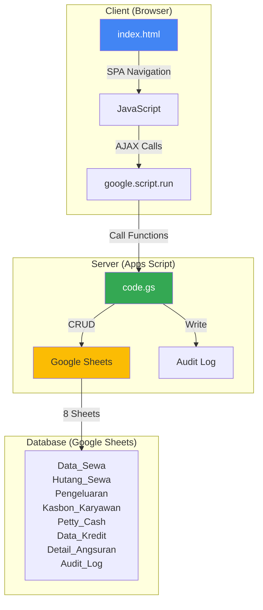

# 🏍️ Rental Management System (RMS)

> Sistem manajemen rental motor berbasis Google Apps Script dengan fitur lengkap untuk pengelolaan transaksi, keuangan, dan laporan.

[🇬🇧 English Version](./README.en.md) | [📖 Panduan Deployment](./DEPLOYMENT.md) | [🔗 Live Demo](https://your-username.github.io/RMS/)

[](https://opensource.org/licenses/MIT)
[](https://developers.google.com/apps-script)
[](https://github.com/your-username/RMS)

---

## 📋 Daftar Isi

- [Overview](#-overview)
- [Fitur Utama](#-fitur-utama)
- [Role & Permissions](#-role--permissions)
- [Tech Stack](#-tech-stack)
- [Arsitektur](#-arsitektur)
- [Database Schema](#-database-schema)
- [Setup & Installation](#-setup--installation)
- [Demo](#-demo)
- [Screenshots](#-screenshots)
- [Limitations](#-limitations)
- [Changelog](#-changelog)
- [License](#-license)

---

## 🌟 Overview

**RMS (Rental Management System)** adalah aplikasi web full-stack untuk mengelola bisnis rental motor, dibangun sepenuhnya dengan Google Apps Script dan Google Sheets sebagai database. Sistem ini menyediakan interface modern dengan role-based access control untuk 3 jenis user: Admin, Financial, dan Management.

### Kenapa Menggunakan Apps Script?

- ✅ **Zero Infrastructure Cost** - Hosting gratis dari Google
- ✅ **Built-in Database** - Google Sheets sebagai database
- ✅ **Auto Backup** - Revision history bawaan Google Drive
- ✅ **Easy Collaboration** - Share access seperti Google Docs
- ✅ **Mobile Responsive** - Akses dari HP/tablet
- ✅ **No Server Maintenance** - Fully managed oleh Google

### Use Case

Ideal untuk:
- 🏪 Usaha rental motor skala kecil-menengah (10-100 unit)
- 💼 Owner yang ingin monitoring real-time
- 📊 Tim yang butuh laporan keuangan otomatis
- 🔐 Multi-user dengan pembagian akses (kasir, finance, owner)

---

## ✨ Fitur Utama

### 🔐 Admin Role
**Dashboard:**
- Total pendapatan hari ini, minggu ini, bulan ini
- Unit tersedia vs disewa (real-time)
- Top 5 hutang pelanggan
- Quick action: Tambah rental, cek hutang

**Transaksi Rental:**
- ➕ Tambah rental baru (Harian/Mingguan/Bulanan)
- ✏️ Edit rental aktif
- 🔄 Swap unit (ganti motor customer)
- ⏰ Perpanjang durasi rental
- ✅ Selesaikan rental + bayar hutang
- 🚫 Batalkan rental (dengan reason)

**Manajemen Hutang:**
- 📋 Daftar semua hutang sewa
- 💰 Bayar sebagian/lunas
- 🔍 Filter berdasarkan status (Lunas/Belum Lunas)
- 📄 Export ke Excel

**Kredit Motor:**
- 📝 Input data kredit motor baru
- 💳 Catat pembayaran angsuran
- 📊 Tracking sisa angsuran & jatuh tempo
- ⚠️ Notifikasi angsuran mendekati jatuh tempo

**Kas Kecil (Petty Cash):**
- 💵 Input modal kas kecil
- ➖ Catat transaksi keluar (bensin, parkir, dll)
- 📈 Tracking saldo kas kecil real-time
- 🔄 Top-up modal

### 💼 Financial Role
**Pengeluaran:**
- ➕ Tambah pengeluaran (Service, Bensin, Pajak, dll)
- ✏️ Edit/hapus pengeluaran
- 📊 Laporan pengeluaran per kategori
- 📅 Filter berdasarkan tanggal

**Kasbon Karyawan:**
- 📝 Input kasbon karyawan
- 💰 Catat pembayaran kasbon
- 📋 Daftar kasbon aktif + history
- 📊 Total kasbon per karyawan

**Pendapatan Lain:**
- 💵 Catat pendapatan di luar rental (jual helm, dll)
- 🏷️ Kategorisasi pendapatan
- 📈 Tracking total pendapatan tambahan

**Laporan Keuangan:**
- 📊 Income Statement (Laba/Rugi)
- 💰 Cash Flow Report
- 📈 Grafik pendapatan vs pengeluaran
- 📅 Filter berdasarkan periode
- 📄 Export ke PDF/Excel

### 📊 Management Role
**Dashboard Eksekutif:**
- 📈 Grafik pendapatan bulanan (6 bulan terakhir)
- 💵 Total revenue vs expenses
- 🎯 KPI: Occupancy rate, avg rental duration
- 🏆 Top performing units

**Laporan Lengkap:**
- 📊 Semua laporan dari Admin + Financial
- 🔍 Advanced filtering & search
- 📅 Custom date range
- 📄 Bulk export

**Audit Log:**
- 🕐 History semua transaksi (siapa, kapan, apa)
- 🔍 Filter berdasarkan user/action/date
- 🔐 Read-only (tidak bisa diubah)
- 📄 Export untuk audit

**Manajemen Unit:**
- 🏍️ Daftar semua unit motor
- 🔧 Status unit (Tersedia/Disewa/Maintenance)
- 📊 Statistik per unit (total rental, pendapatan)
- 📅 History rental per unit

---

## 🔐 Role & Permissions

| Fitur | Admin | Financial | Management |
|-------|:-----:|:---------:|:----------:|
| **Dashboard** | ✅ | ✅ | ✅ |
| **Transaksi Rental** | ✅ | ❌ | ✅ (Read-only) |
| **Hutang Sewa** | ✅ | ❌ | ✅ (Read-only) |
| **Kredit Motor** | ✅ | ❌ | ✅ (Read-only) |
| **Kas Kecil** | ✅ | ❌ | ✅ (Read-only) |
| **Pengeluaran** | ❌ | ✅ | ✅ (Read-only) |
| **Kasbon Karyawan** | ❌ | ✅ | ✅ (Read-only) |
| **Pendapatan Lain** | ❌ | ✅ | ✅ (Read-only) |
| **Laporan Keuangan** | ❌ | ✅ | ✅ |
| **Audit Log** | ❌ | ❌ | ✅ |
| **Manajemen Unit** | ✅ | ❌ | ✅ |

**Default Passwords (Production):**
- Admin: `admin123` (⚠️ Harus diganti di sheet Konfigurasi)
- Financial: `finance123`
- Management: `mgmt123`

**Demo Passwords:**
- Semua role: `demo123`

---

## 🛠️ Tech Stack

### Frontend
- **HTML5/CSS3** - Responsive UI dengan Flexbox/Grid
- **JavaScript (ES6+)** - Vanilla JS (no framework)
- **Bootstrap Icons** - Icon library
- **Chart.js** - Grafik interaktif

### Backend
- **Google Apps Script** - Server-side JavaScript
- **V8 Runtime** - Modern JavaScript support (async/await, spread, etc)

### Database
- **Google Sheets** - 8 sheets sebagai relational tables:
  1. `Data_Sewa` - Transaksi rental (49 kolom)
  2. `Hutang_Sewa` - Hutang pelanggan
  3. `Pengeluaran` - Expense tracking
  4. `Kasbon_Karyawan` - Employee loans
  5. `Petty_Cash` - Kas kecil
  6. `Data_Kredit` - Data motor kredit
  7. `Detail_Angsuran` - Installment payments
  8. `Audit_Log` - Transaction history

### Architecture
- **SPA (Single Page Application)** - Client-side routing
- **Server-side Rendering** - `HtmlService.createTemplateFromFile()`
- **AJAX Communication** - `google.script.run` API
- **Role-based Access Control (RBAC)** - Password-based authentication

---

## 🏗️ Arsitektur



### Data Flow

1. **User Login** → Password validated against sheet `Konfigurasi`
2. **Dashboard Load** → `google.script.run.getDashboardData()` → Aggregate dari multiple sheets
3. **Add Rental** → Form submit → `addRental(formData)` → Append ke `Data_Sewa` + write `Audit_Log`
4. **Reports** → `getFinancialReport(startDate, endDate)` → Query & calculate → Return JSON

### Key Design Patterns

- **Proxy Pattern** - `google.script.run` dengan `.withSuccessHandler()` / `.withFailureHandler()`
- **Observer Pattern** - Event listeners untuk form submit, navigation
- **Factory Pattern** - Dynamic UI generation berdasarkan role
- **Singleton Pattern** - Sheet connection via `getSheet_()` helper

---

## 📊 Database Schema

### Data_Sewa (49 Kolom)
**Primary Table untuk transaksi rental**

| Kolom | Type | Deskripsi | Contoh |
|-------|------|-----------|--------|
| `Timestamp` | Date | Waktu transaksi dibuat | `2026-11-09 14:30:00` |
| `NamaPelanggan` | String | Nama customer | `Budi Santoso` |
| `NoHP` | String | Nomor HP customer | `081234567890` |
| `Alamat` | Text | Alamat lengkap | `Jl. Merdeka No. 10` |
| `NoIdentitas` | String | KTP/SIM | `3578012345678901` |
| `NamaPenjamin` | String | Nama penjamin | `Ahmad Ali` |
| `HPPenjamin` | String | HP penjamin | `081234567891` |
| `Unit` | String | Nama/nomor motor | `Vario 150 - B1234XYZ` |
| `TipeRental` | Enum | Harian/Mingguan/Bulanan | `Harian` |
| `DurasiHari` | Number | Durasi sewa (hari) | `3` |
| `TglMulai` | Date | Tanggal mulai sewa | `2026-11-09` |
| `TglSelesai` | Date | Tanggal selesai sewa | `2026-11-12` |
| `HargaPerHari` | Number | Harga per hari | `50000` |
| `TotalBiaya` | Number | Total biaya sewa | `150000` |
| `UangMuka` | Number | Down payment | `100000` |
| `Sisa` | Number | Sisa yang harus dibayar | `50000` |
| `MetodePembayaran` | Enum | CASH/TRANSFER/E-WALLET | `CASH` |
| `Status` | Enum | Aktif/Selesai/Batal | `Aktif` |
| `ActionHistory` | Text | Log perubahan status | `[2026-11-09] Input Awal\n[2026-11-12] Selesai` |
| ... | ... | +30 kolom lainnya | ... |

**[Lihat dokumentasi lengkap](./sample-data/SCHEMA.md)**

### Relasi Antar Sheet

```
Data_Sewa (1) -----> (N) Hutang_Sewa
    └─ NamaPelanggan + NoHP sebagai foreign key

Data_Kredit (1) -----> (N) Detail_Angsuran
    └─ Nomor Polisi sebagai foreign key

Kasbon_Karyawan (1) -----> (N) Kasbon_Karyawan (payment history)
    └─ Nama Karyawan sebagai foreign key

Audit_Log -----> Semua tables
    └─ SheetName + Action + Data (JSON)
```

---

## 🚀 Setup & Installation

### Prerequisites

- Google Account
- Google Sheets access
- (Optional) Node.js + clasp untuk local development

### Option 1: Deploy dari Repository

1. **Clone repository:**
   ```bash
   git clone https://github.com/your-username/RMS.git
   cd RMS
   ```

2. **Install clasp (Google Apps Script CLI):**
   ```bash
   npm install -g @google/clasp
   clasp login
   ```

3. **Buat Google Sheets baru:**
   - Buka [Google Sheets](https://sheets.google.com)
   - Create new spreadsheet
   - Buat 8 sheets: `Data_Sewa`, `Hutang_Sewa`, `Pengeluaran`, `Kasbon_Karyawan`, `Petty_Cash`, `Data_Kredit`, `Detail_Angsuran`, `Audit_Log`, `Konfigurasi`
   - Copy Spreadsheet ID dari URL (di antara `/d/` dan `/edit`)

4. **Setup clasp:**
   ```bash
   clasp create --type webapp --title "RMS" --rootDir ./src
   # Atau jika sudah ada spreadsheet:
   clasp clone <SCRIPT_ID>
   ```

5. **Push code:**
   ```bash
   cd src
   clasp push
   ```

6. **Deploy sebagai Web App:**
   ```bash
   clasp deploy --description "Production v1.0"
   ```
   
   Atau via Apps Script Editor:
   - Buka Apps Script Editor (Extensions → Apps Script)
   - Deploy → New Deployment
   - Type: Web App
   - Execute as: User accessing the web app
   - Who has access: Anyone
   - Copy Web App URL

7. **Setup initial data di sheet Konfigurasi:**
   ```
   | Key            | Value                |
   |----------------|----------------------|
   | COMPANY_NAME   | Nama Rental Anda     |
   | COMPANY_ADDRESS| Alamat lengkap       |
   | ADMIN_CONTACT  | 081234567890         |
   | PASSWORD_ADMIN | admin123             |
   | PASSWORD_FINANCIAL | finance123       |
   | PASSWORD_MANAGEMENT | mgmt123         |
   ```

8. **Test aplikasi:**
   - Buka Web App URL
   - Login dengan role Admin (password: `admin123`)
   - Coba tambah rental test

### Option 2: Import dari Template

1. **Copy Spreadsheet Template:**
   - [Link Template](https://docs.google.com/spreadsheets/d/YOUR_TEMPLATE_ID) (Coming Soon)
   - File → Make a copy
   - Rename sesuai kebutuhan

2. **Setup Script:**
   - Extensions → Apps Script
   - Copy semua code dari `src/code.gs` ke Apps Script Editor
   - File → New → HTML → Paste `src/index.html`
   - File → New → HTML → Paste `src/dev-control.html`

3. **Deploy:**
   - Follow step 6-8 dari Option 1

### Option 3: Demo Mode (GitHub Pages)

Lihat [Live Demo](https://your-username.github.io/RMS/) - Read-only, data fiktif

---

## 🎮 Demo

### Live Demo (Static)
🔗 **[https://your-username.github.io/RMS/](https://your-username.github.io/RMS/)**

- ✅ Full UI/UX demo
- ✅ Semua role (Admin/Financial/Management)
- ✅ Data fiktif realistis (auto-generated dengan tanggal dinamis)
- ⚠️ Read-only (write operations disabled)
- ⚠️ No backend (client-side shim)

**Credentials:**
- Username: `admin` / `Financial` / `Management`
- Password: `demo123` (semua role)

### Live Demo (Backend)
🔗 **[Coming Soon - Live Apps Script Demo]**

- ✅ Full functionality (read + write)
- ✅ Real Google Sheets backend
- ⚠️ Data akan direset setiap 24 jam
- ⚠️ Shared dengan semua pengunjung (jangan input data sensitif)

### Local Development

```bash
# Clone repository
git clone https://github.com/your-username/RMS.git
cd RMS

# Install dependencies
npm install -g @google/clasp

# Login ke Google
clasp login

# Clone script dari production
clasp clone <SCRIPT_ID>

# Edit local
code src/

# Push changes
clasp push

# Open in browser
clasp open --webapp
```

---

## 📸 Screenshots

### Dashboard Admin

*Real-time metrics, quick actions, dan top debtors*

### Form Tambah Rental

*Input lengkap: customer, unit, durasi, pembayaran*

### Laporan Keuangan

*Income statement dengan grafik pendapatan vs pengeluaran*

### Audit Log (Management)

*History semua transaksi untuk monitoring*

**[Lihat semua screenshots →](./screenshots/)**

---

## ⚠️ Limitations

### Known Issues

1. **Authentication Client-Side Only**
   - ⚠️ Password di-check di frontend (JavaScript)
   - ⚠️ Bisa di-bypass oleh technical user (buka console, edit variable)
   - ✅ Aman untuk internal team usage
   - ❌ Tidak aman untuk public exposure

2. **No Data Validation di Backend**
   - ⚠️ Semua validasi di client-side (JavaScript)
   - ⚠️ Direct sheet access bisa corrupt data
   - ✅ Mitigation: Protected sheets + Audit Log

3. **Performance dengan Data Besar**
   - ⚠️ Sheet dengan >10,000 rows bisa lambat
   - ⚠️ Dashboard load time >5s jika banyak data
   - ✅ Mitigation: Arsip data lama ke sheet terpisah

4. **No Real-time Sync**
   - ⚠️ Data tidak auto-refresh (harus reload page)
   - ⚠️ Concurrent edit bisa overwrite data
   - ✅ Mitigation: Audit log untuk tracking changes

5. **Duplicate Functions di Code.gs**
   - ⚠️ 4 functions ada 2 definisi: `updateExpense`, `deleteExpense`, `updateEmployeeLoan`, `deleteEmployeeLoan`
   - ✅ Safe: JavaScript uses last definition, both identical
   - 📝 Future: Clean up redundant code

### Recommendations

- ✅ Use for internal team (3-10 users)
- ✅ Regular backup (File → Make a copy)
- ✅ Protect sheets (Data → Protect sheets and ranges)
- ✅ Change default passwords
- ❌ Don't expose publicly without proper authentication
- ❌ Don't store customer credit card / sensitive financial data

---

## 📝 Changelog

### v2.0.0 (2026-11-09) - Portfolio Release
**Added:**
- ✨ DEMO_MODE system dengan `assertWritable_()` protection
- ✨ Seed scripts: `seedDemoData()` dan `clearAllDemoData()`
- ✨ Static demo untuk GitHub Pages (`docs/index.html` + shim)
- 📚 Comprehensive documentation (README, DEPLOYMENT, SCHEMA, CHANGELOG)

**Changed:**
- 🔒 Sanitized sensitive data (company name, contacts) dengan placeholders
- 🔧 Renamed internal helpers ke private convention (`_` suffix)
- 🧹 Cleaned `doGet()` - removed dev-control branch
- 🗑️ Removed duplicate `moveToHutangSewa` function

**Fixed:**
- 🐛 Audit Log navigation bug (`'audit-log'` → `'Management-audit'`)
- 🐛 Audit Log loader (`loadAuditLog` → `loadAuditLogData`)

**Security:**
- 🔐 All write functions protected dengan `assertWritable_()`
- 🔐 Helper functions marked private (prevent console calls)
- 🔐 Data placeholders untuk public repository

[Lihat full changelog →](./BACKEND_CHANGELOG.md)

### v1.0.0 (2025-XX-XX) - Initial Production Release
- 🎉 First stable release
- ✅ 3 role system (Admin/Financial/Management)
- ✅ 8 modules: Rental, Hutang, Kredit, Kas Kecil, Pengeluaran, Kasbon, Laporan, Audit
- ✅ Responsive UI untuk mobile/desktop
- ✅ Chart.js integration untuk grafik

---

## 🤝 Contributing

Contributions welcome! Silakan fork repository ini dan submit Pull Request.

### Development Setup

```bash
# Fork di GitHub, lalu clone
git clone https://github.com/your-username/RMS.git
cd RMS

# Create feature branch
git checkout -b feature/amazing-feature

# Install clasp
npm install -g @google/clasp

# Setup local development
clasp login
clasp clone <YOUR_SCRIPT_ID>

# Make changes
code src/

# Test locally
clasp push
clasp open --webapp

# Commit
git add .
git commit -m "Add amazing feature"

# Push to GitHub
git push origin feature/amazing-feature

# Create Pull Request di GitHub
```

### Coding Guidelines

- ✅ Follow existing code style (2 spaces indent, camelCase)
- ✅ Add JSDoc comments untuk functions
- ✅ Test dengan minimal 2 roles (Admin + Financial/Management)
- ✅ Update CHANGELOG.md
- ✅ No console.log di production code
- ✅ Use private helpers dengan suffix `_`

---

## 📄 License

MIT License - see [LICENSE](./LICENSE) file for details.

**Copyright © 2026 Fyan's**

---

## 🙏 Acknowledgments

- Google Apps Script team untuk platform yang powerful
- Bootstrap team untuk icon library
- Chart.js untuk grafik yang indah
- Community contributors

---

## 📞 Contact

**Developer:** Fyan's

**Project Link:** [https://github.com/your-username/RMS](https://github.com/your-username/RMS)

**Live Demo:** [https://your-username.github.io/RMS/](https://your-username.github.io/RMS/)

---

**⭐ Star this repo if you find it useful!**

**🐛 Found a bug? [Open an issue](https://github.com/your-username/RMS/issues)**

**💡 Have a feature request? [Start a discussion](https://github.com/your-username/RMS/discussions)**
