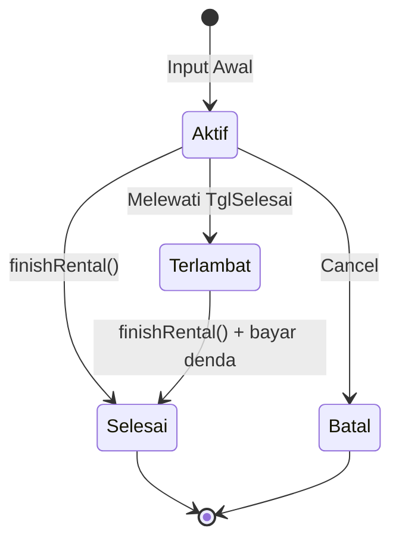
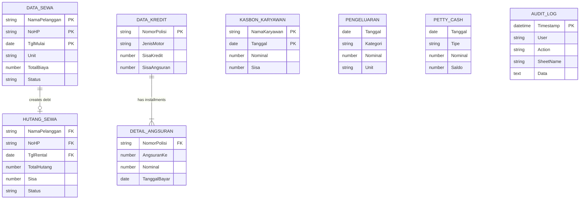

# 📊 Database Schema Documentation

> Dokumentasi lengkap struktur database Google Sheets untuk RMS

[🏠 Back to README](../README.md)

---

## 📋 Overview

RMS menggunakan **Google Sheets** sebagai database dengan **8 sheets** sebagai relational tables. Semua data disimpan dalam format spreadsheet dengan kolom-kolom terstruktur.

### Sheet List

1. **Data_Sewa** (49 kolom) - Primary rental transactions
2. **Hutang_Sewa** - Customer debts
3. **Pengeluaran** - Expenses tracking
4. **Kasbon_Karyawan** - Employee loans
5. **Petty_Cash** - Petty cash management
6. **Data_Kredit** - Motorcycle credit data
7. **Detail_Angsuran** - Credit installment payments
8. **Audit_Log** - Transaction history (read-only)

**Total Estimated Storage:** ~10 MB untuk 1000 transaksi rental

---

## 1️⃣ Data_Sewa (49 Columns)

**Purpose:** Main table untuk semua transaksi rental motor

**Row Limit:** ~100,000 rows (Google Sheets limit: 10M cells total)

### Schema Definition

| # | Column Name | Type | Required | Default | Description | Example |
|---|-------------|------|----------|---------|-------------|---------|
| 1 | `Timestamp` | DateTime | ✅ | `NOW()` | Waktu transaksi dibuat | `2026-11-09 14:30:00` |
| 2 | `NamaPelanggan` | String(100) | ✅ | - | Nama lengkap customer | `Budi Santoso` |
| 3 | `NoHP` | String(15) | ✅ | - | Nomor HP customer | `081234567890` |
| 4 | `Alamat` | Text(500) | ✅ | - | Alamat lengkap customer | `Jl. Merdeka No. 10, Surabaya` |
| 5 | `NoIdentitas` | String(20) | ✅ | - | Nomor KTP/SIM | `3578012345678901` |
| 6 | `NamaPenjamin` | String(100) | ❌ | `-` | Nama penjamin/guarantor | `Ahmad Ali` |
| 7 | `HPPenjamin` | String(15) | ❌ | `-` | HP penjamin | `081234567891` |
| 8 | `AlamatPenjamin` | Text(500) | ❌ | `-` | Alamat penjamin | `Jl. Pahlawan No. 5` |
| 9 | `Unit` | String(50) | ✅ | - | Nama/nomor unit motor | `Vario 150 - B1234XYZ` |
| 10 | `TipeRental` | Enum | ✅ | `Harian` | Harian/Mingguan/Bulanan | `Harian` |
| 11 | `DurasiHari` | Number | ✅ | `1` | Durasi sewa dalam hari | `3` |
| 12 | `TglMulai` | Date | ✅ | Today | Tanggal mulai sewa | `2026-11-09` |
| 13 | `TglSelesai` | Date | ✅ | Calculated | Tanggal selesai sewa | `2026-11-12` |
| 14 | `HargaPerHari` | Currency | ✅ | - | Harga per hari (Rp) | `50000` |
| 15 | `TotalBiaya` | Currency | ✅ | Calculated | Total biaya = Harga × Durasi | `150000` |
| 16 | `UangMuka` | Currency | ✅ | `0` | Down payment / DP | `100000` |
| 17 | `Sisa` | Currency | ✅ | Calculated | Sisa = Total - UangMuka | `50000` |
| 18 | `MetodePembayaran` | Enum | ✅ | `CASH` | CASH/TRANSFER/E-WALLET | `CASH` |
| 19 | `Status` | Enum | ✅ | `Aktif` | Aktif/Selesai/Batal/Terlambat | `Aktif` |
| 20 | `Keterangan` | Text(500) | ❌ | `-` | Catatan tambahan | `Helm sudah dibawa` |
| 21 | `ActionHistory` | Text(2000) | ✅ | Auto | Log perubahan status | `[2026-11-09] Input Awal\n[2026-11-12] Selesai` |
| 22 | `CreatedBy` | String(50) | ✅ | `admin` | User yang create | `admin` |
| 23 | `LastModifiedBy` | String(50) | ✅ | `admin` | User terakhir edit | `admin` |
| 24 | `LastModified` | DateTime | ✅ | `NOW()` | Waktu terakhir diubah | `2026-11-09 15:00:00` |
| 25 | `TglKembali` | Date | ❌ | `null` | Tanggal actual return | `2026-11-12` |
| 26 | `DendaHarian` | Currency | ❌ | `0` | Denda per hari | `10000` |
| 27 | `TotalDenda` | Currency | ❌ | `0` | Total denda terlambat | `0` |
| 28 | `BiayaTambahan` | Currency | ❌ | `0` | Biaya lain (rusak, dll) | `0` |
| 29 | `KeteranganBiayaTambahan` | Text(500) | ❌ | `-` | Alasan biaya tambahan | `Spion pecah` |
| 30 | `GrandTotal` | Currency | ✅ | Calculated | Total + Denda + BiayaTambahan | `150000` |
| 31 | `TotalPembayaran` | Currency | ✅ | Calculated | Sum semua payment | `150000` |
| 32 | `SisaPembayaran` | Currency | ✅ | Calculated | GrandTotal - TotalPembayaran | `0` |
| 33 | `StatusPembayaran` | Enum | ✅ | Calculated | Lunas/Belum Lunas | `Lunas` |
| 34 | `KMSebelum` | Number | ❌ | `0` | KM awal motor | `15000` |
| 35 | `KMSesudah` | Number | ❌ | `0` | KM akhir motor | `15500` |
| 36 | `TotalKM` | Number | ❌ | Calculated | KMSesudah - KMSebelum | `500` |
| 37 | `FotoBuktiTransfer` | URL | ❌ | `-` | Link foto bukti transfer | `https://drive.google.com/...` |
| 38 | `FotoKTP` | URL | ❌ | `-` | Link foto KTP customer | `https://drive.google.com/...` |
| 39 | `FotoUnitSebelum` | URL | ❌ | `-` | Link foto unit sebelum rental | `https://drive.google.com/...` |
| 40 | `FotoUnitSesudah` | URL | ❌ | `-` | Link foto unit setelah return | `https://drive.google.com/...` |
| 41 | `SwapHistory` | Text(1000) | ❌ | `-` | History swap unit | `[2026-11-10] B1234XYZ → B5678ABC` |
| 42 | `PerpanjanganCount` | Number | ❌ | `0` | Jumlah perpanjangan | `1` |
| 43 | `OriginalTglSelesai` | Date | ❌ | `null` | Tanggal selesai original | `2026-11-11` |
| 44 | `CancelReason` | Text(500) | ❌ | `-` | Alasan pembatalan | `Customer cancel` |
| 45 | `CancelledBy` | String(50) | ❌ | `-` | User yang cancel | `admin` |
| 46 | `CancelledAt` | DateTime | ❌ | `null` | Waktu dibatalkan | `2026-11-09 16:00:00` |
| 47 | `IsDeleted` | Boolean | ✅ | `FALSE` | Soft delete flag | `FALSE` |
| 48 | `DeletedBy` | String(50) | ❌ | `-` | User yang delete | `-` |
| 49 | `DeletedAt` | DateTime | ❌ | `null` | Waktu dihapus | `null` |

### Calculated Fields

```javascript
// TglSelesai = TglMulai + DurasiHari
TglSelesai = new Date(TglMulai.getTime() + DurasiHari * 86400000);

// TotalBiaya = HargaPerHari × DurasiHari
TotalBiaya = HargaPerHari * DurasiHari;

// Sisa = TotalBiaya - UangMuka
Sisa = TotalBiaya - UangMuka;

// GrandTotal = TotalBiaya + TotalDenda + BiayaTambahan
GrandTotal = TotalBiaya + TotalDenda + BiayaTambahan;

// SisaPembayaran = GrandTotal - TotalPembayaran
SisaPembayaran = GrandTotal - TotalPembayaran;

// StatusPembayaran
StatusPembayaran = (SisaPembayaran <= 0) ? "Lunas" : "Belum Lunas";

// TotalKM = KMSesudah - KMSebelum
TotalKM = KMSesudah - KMSebelum;
```

### Status Flow



### Sample Data

```csv
Timestamp,NamaPelanggan,NoHP,Alamat,NoIdentitas,Unit,TipeRental,DurasiHari,TglMulai,TglSelesai,HargaPerHari,TotalBiaya,UangMuka,Sisa,MetodePembayaran,Status
2026-11-09 10:00:00,Budi Santoso,081234567890,Jl. Merdeka No. 10,3578012345678901,Vario 150 - B1234XYZ,Harian,3,2026-11-09,2026-11-12,50000,150000,100000,50000,CASH,Aktif
2026-11-08 14:30:00,Siti Aminah,081234567891,Jl. Pahlawan No. 5,3578012345678902,Beat Street - B5678ABC,Mingguan,7,2026-11-08,2026-11-15,40000,280000,280000,0,TRANSFER,Aktif
2026-11-07 09:15:00,Ahmad Ali,081234567892,Jl. Sudirman No. 20,3578012345678903,PCX 160 - B9012DEF,Bulanan,30,2026-11-07,2026-12-07,60000,1800000,1800000,0,E-WALLET,Selesai
```

---

## 2️⃣ Hutang_Sewa

**Purpose:** Tracking customer debts dari rental yang belum lunas

### Schema Definition

| # | Column Name | Type | Required | Description | Example |
|---|-------------|------|----------|-------------|---------|
| 1 | `Timestamp` | DateTime | ✅ | Waktu hutang dibuat | `2026-11-09 14:30:00` |
| 2 | `NamaPelanggan` | String(100) | ✅ | Nama customer (FK) | `Budi Santoso` |
| 3 | `NoHP` | String(15) | ✅ | HP customer (FK) | `081234567890` |
| 4 | `Unit` | String(50) | ✅ | Unit yang disewa | `Vario 150 - B1234XYZ` |
| 5 | `TglRental` | Date | ✅ | Tanggal rental | `2026-11-09` |
| 6 | `TotalHutang` | Currency | ✅ | Total hutang awal | `50000` |
| 7 | `TotalBayar` | Currency | ✅ | Total yang sudah dibayar | `20000` |
| 8 | `Sisa` | Currency | ✅ | Sisa hutang | `30000` |
| 9 | `Status` | Enum | ✅ | Lunas/Belum Lunas | `Belum Lunas` |
| 10 | `PaymentHistory` | Text(2000) | ✅ | Log pembayaran | `[2026-11-10] Bayar Rp20,000 - CASH` |
| 11 | `LastPaymentDate` | Date | ❌ | Tanggal bayar terakhir | `2026-11-10` |
| 12 | `CreatedBy` | String(50) | ✅ | User yang create | `admin` |

### Relationships

```
Data_Sewa (1) -----> (0..1) Hutang_Sewa
  NamaPelanggan + NoHP + TglRental (Composite FK)
```

### Sample Data

```csv
Timestamp,NamaPelanggan,NoHP,Unit,TglRental,TotalHutang,TotalBayar,Sisa,Status,PaymentHistory
2026-11-09 14:30:00,Budi Santoso,081234567890,Vario 150 - B1234XYZ,2026-11-09,50000,20000,30000,Belum Lunas,[2026-11-10] Bayar Rp20000 - CASH
2026-11-08 10:00:00,Dewi Lestari,081234567893,Beat Street - B5678ABC,2026-11-08,100000,100000,0,Lunas,[2026-11-12] Bayar Rp100000 - TRANSFER
```

---

## 3️⃣ Pengeluaran

**Purpose:** Expense tracking untuk operational costs

### Schema Definition

| # | Column Name | Type | Required | Description | Example |
|---|-------------|------|----------|-------------|---------|
| 1 | `Timestamp` | DateTime | ✅ | Waktu transaksi | `2026-11-09 10:00:00` |
| 2 | `Tanggal` | Date | ✅ | Tanggal pengeluaran | `2026-11-09` |
| 3 | `Kategori` | Enum | ✅ | Service/Bensin/Pajak/Lainnya | `Service` |
| 4 | `Deskripsi` | Text(500) | ✅ | Detail pengeluaran | `Ganti oli Vario 150` |
| 5 | `Unit` | String(50) | ❌ | Unit terkait (jika ada) | `Vario 150 - B1234XYZ` |
| 6 | `Nominal` | Currency | ✅ | Jumlah pengeluaran | `150000` |
| 7 | `MetodePembayaran` | Enum | ✅ | CASH/TRANSFER/E-WALLET | `CASH` |
| 8 | `CreatedBy` | String(50) | ✅ | User yang input | `Financial` |
| 9 | `FotoBukti` | URL | ❌ | Link foto nota/kwitansi | `https://drive.google.com/...` |
| 10 | `Keterangan` | Text(500) | ❌ | Catatan tambahan | `Termasuk ganti filter` |

### Categories

- `Service` - Maintenance motor
- `Bensin` - Fuel costs
- `Pajak` - Tax payments
- `Asuransi` - Insurance
- `Gaji` - Salaries (deprecated, use Kasbon_Karyawan)
- `Lainnya` - Other expenses

### Sample Data

```csv
Timestamp,Tanggal,Kategori,Deskripsi,Unit,Nominal,MetodePembayaran,CreatedBy
2026-11-09 10:00:00,2026-11-09,Service,Ganti oli Vario 150,Vario 150 - B1234XYZ,150000,CASH,Financial
2026-11-08 15:30:00,2026-11-08,Bensin,Isi bensin semua unit,-,500000,CASH,Financial
2026-11-07 09:00:00,2026-11-07,Pajak,Pajak tahunan B1234XYZ,Vario 150 - B1234XYZ,500000,TRANSFER,Financial
```

---

## 4️⃣ Kasbon_Karyawan

**Purpose:** Employee loan tracking

### Schema Definition

| # | Column Name | Type | Required | Description | Example |
|---|-------------|------|----------|-------------|---------|
| 1 | `Timestamp` | DateTime | ✅ | Waktu transaksi | `2026-11-09 10:00:00` |
| 2 | `Tanggal` | Date | ✅ | Tanggal kasbon | `2026-11-09` |
| 3 | `NamaKaryawan` | String(100) | ✅ | Nama karyawan | `Andi Wijaya` |
| 4 | `Nominal` | Currency | ✅ | Jumlah kasbon | `500000` |
| 5 | `Keterangan` | Text(500) | ✅ | Alasan kasbon | `Biaya rumah sakit` |
| 6 | `Status` | Enum | ✅ | Belum Lunas/Lunas | `Belum Lunas` |
| 7 | `TotalBayar` | Currency | ✅ | Yang sudah dibayar | `200000` |
| 8 | `Sisa` | Currency | ✅ | Sisa kasbon | `300000` |
| 9 | `PaymentHistory` | Text(2000) | ✅ | Log pembayaran | `[2026-11-15] Bayar Rp200000` |
| 10 | `DueDate` | Date | ❌ | Target pelunasan | `2026-12-09` |
| 11 | `CreatedBy` | String(50) | ✅ | User yang input | `Financial` |

### Sample Data

```csv
Timestamp,Tanggal,NamaKaryawan,Nominal,Keterangan,Status,TotalBayar,Sisa,PaymentHistory,DueDate
2026-11-09 10:00:00,2026-11-09,Andi Wijaya,500000,Biaya rumah sakit,Belum Lunas,200000,300000,[2026-11-15] Bayar Rp200000,2026-12-09
2026-11-05 14:00:00,2026-11-05,Budi Setiawan,1000000,Modal usaha,Lunas,1000000,0,[2026-11-20] Bayar Rp1000000,2026-12-05
```

---

## 5️⃣ Petty_Cash

**Purpose:** Petty cash management (kas kecil)

### Schema Definition

| # | Column Name | Type | Required | Description | Example |
|---|-------------|------|----------|-------------|---------|
| 1 | `Timestamp` | DateTime | ✅ | Waktu transaksi | `2026-11-09 08:00:00` |
| 2 | `Tanggal` | Date | ✅ | Tanggal transaksi | `2026-11-09` |
| 3 | `Tipe` | Enum | ✅ | MODAL/KELUAR | `KELUAR` |
| 4 | `Deskripsi` | Text(500) | ✅ | Detail transaksi | `Bensin motor` |
| 5 | `Nominal` | Currency | ✅ | Jumlah (+ untuk modal, - untuk keluar) | `50000` |
| 6 | `Saldo` | Currency | ✅ | Saldo setelah transaksi | `450000` |
| 7 | `CreatedBy` | String(50) | ✅ | User yang input | `admin` |
| 8 | `Keterangan` | Text(500) | ❌ | Catatan tambahan | `Pertamax` |

### Transaction Types

- `MODAL` - Capital input (increase balance)
- `KELUAR` - Expense (decrease balance)

### Sample Data

```csv
Timestamp,Tanggal,Tipe,Deskripsi,Nominal,Saldo,CreatedBy
2026-11-01 08:00:00,2026-11-01,MODAL,Modal awal,500000,500000,admin
2026-11-09 08:00:00,2026-11-09,KELUAR,Bensin motor,50000,450000,admin
2026-11-09 10:00:00,2026-11-09,KELUAR,Parkir,5000,445000,admin
```

---

## 6️⃣ Data_Kredit

**Purpose:** Motorcycle credit data (motor kredit perusahaan)

### Schema Definition

| # | Column Name | Type | Required | Description | Example |
|---|-------------|------|----------|-------------|---------|
| 1 | `Timestamp` | DateTime | ✅ | Waktu input | `2026-11-09 10:00:00` |
| 2 | `TanggalBeli` | Date | ✅ | Tanggal beli motor | `2026-11-01` |
| 3 | `NomorPolisi` | String(20) | ✅ | Nomor polisi (PK) | `B1234XYZ` |
| 4 | `JenisMotor` | String(100) | ✅ | Jenis/tipe motor | `Honda Vario 150` |
| 5 | `HargaMotor` | Currency | ✅ | Harga beli motor | `25000000` |
| 6 | `DP` | Currency | ✅ | Down payment | `5000000` |
| 7 | `SisaKredit` | Currency | ✅ | Sisa yang dicicil | `20000000` |
| 8 | `AngsuranPerBulan` | Currency | ✅ | Angsuran bulanan | `1000000` |
| 9 | `TenorBulan` | Number | ✅ | Tenor kredit (bulan) | `20` |
| 10 | `BungaPersen` | Number | ✅ | Bunga per tahun (%) | `5` |
| 11 | `TotalAngsuran` | Number | ✅ | Total angsuran dibayar | `5` |
| 12 | `SisaAngsuran` | Number | ✅ | Sisa angsuran | `15` |
| 13 | `TotalDibayar` | Currency | ✅ | Total yang sudah dibayar | `5000000` |
| 14 | `SisaBelumDibayar` | Currency | ✅ | Sisa yang belum dibayar | `15000000` |
| 15 | `Status` | Enum | ✅ | Aktif/Lunas | `Aktif` |
| 16 | `TanggalJatuhTempo` | Date | ✅ | Tanggal angsuran berikutnya | `2026-12-01` |
| 17 | `Leasing` | String(100) | ✅ | Nama leasing | `BAF` |
| 18 | `CreatedBy` | String(50) | ✅ | User yang input | `admin` |

### Sample Data

```csv
Timestamp,TanggalBeli,NomorPolisi,JenisMotor,HargaMotor,DP,SisaKredit,AngsuranPerBulan,TenorBulan,TotalAngsuran,SisaAngsuran,Status
2026-11-01 10:00:00,2026-11-01,B1234XYZ,Honda Vario 150,25000000,5000000,20000000,1000000,20,5,15,Aktif
2025-06-01 10:00:00,2025-06-01,B5678ABC,Yamaha NMAX,30000000,10000000,20000000,1000000,20,20,0,Lunas
```

---

## 7️⃣ Detail_Angsuran

**Purpose:** Credit installment payment records

### Schema Definition

| # | Column Name | Type | Required | Description | Example |
|---|-------------|------|----------|-------------|---------|
| 1 | `Timestamp` | DateTime | ✅ | Waktu pembayaran | `2026-11-09 10:00:00` |
| 2 | `TanggalBayar` | Date | ✅ | Tanggal bayar | `2026-11-09` |
| 3 | `NomorPolisi` | String(20) | ✅ | Nomor polisi (FK) | `B1234XYZ` |
| 4 | `AngsuranKe` | Number | ✅ | Angsuran ke-berapa | `5` |
| 5 | `Nominal` | Currency | ✅ | Nominal bayar | `1000000` |
| 6 | `MetodePembayaran` | Enum | ✅ | CASH/TRANSFER | `TRANSFER` |
| 7 | `Keterangan` | Text(500) | ❌ | Catatan | `Bayar tepat waktu` |
| 8 | `CreatedBy` | String(50) | ✅ | User yang input | `Financial` |

### Relationships

```
Data_Kredit (1) -----> (N) Detail_Angsuran
  NomorPolisi (FK)
```

### Sample Data

```csv
Timestamp,TanggalBayar,NomorPolisi,AngsuranKe,Nominal,MetodePembayaran,CreatedBy
2026-11-09 10:00:00,2026-11-09,B1234XYZ,5,1000000,TRANSFER,Financial
2026-10-09 10:00:00,2026-10-09,B1234XYZ,4,1000000,TRANSFER,Financial
```

---

## 8️⃣ Audit_Log

**Purpose:** Transaction history untuk monitoring (read-only)

### Schema Definition

| # | Column Name | Type | Required | Description | Example |
|---|-------------|------|----------|-------------|---------|
| 1 | `Timestamp` | DateTime | ✅ | Waktu aksi | `2026-11-09 14:30:00` |
| 2 | `User` | String(50) | ✅ | User yang melakukan aksi | `admin` |
| 3 | `Action` | String(100) | ✅ | Jenis aksi | `addRental` |
| 4 | `SheetName` | String(50) | ✅ | Sheet yang diubah | `Data_Sewa` |
| 5 | `Data` | Text(5000) | ✅ | Data JSON | `{"NamaPelanggan":"Budi","Unit":"B1234XYZ"}` |
| 6 | `Description` | Text(500) | ✅ | Deskripsi human-readable | `Menambahkan rental baru untuk Budi Santoso` |
| 7 | `IPAddress` | String(50) | ❌ | IP address user (jika ada) | `192.168.1.1` |

### Action Types

- `addRental`, `updateRental`, `deleteRental`
- `addExpense`, `updateExpense`, `deleteExpense`
- `addEmployeeLoan`, `updateEmployeeLoan`
- `payDebt`, `addCreditPayment`
- `finishRental`, `extendRental`, `swapUnit`
- `addPettyCashCapital`, `addPettyCashTransaction`
- `login`, `logout`

### Sample Data

```csv
Timestamp,User,Action,SheetName,Data,Description
2026-11-09 14:30:00,admin,addRental,Data_Sewa,"{""NamaPelanggan"":""Budi Santoso"",""Unit"":""B1234XYZ""}",Menambahkan rental baru untuk Budi Santoso
2026-11-09 15:00:00,Financial,addExpense,Pengeluaran,"{""Kategori"":""Service"",""Nominal"":150000}",Menambahkan pengeluaran service motor
```

---

## 9️⃣ Konfigurasi

**Purpose:** System configuration (passwords, company info)

### Schema Definition

| # | Column Name | Type | Description | Example |
|---|-------------|------|-------------|---------|
| 1 | `Key` | String(50) | Config key | `COMPANY_NAME` |
| 2 | `Value` | Text(500) | Config value | `Demo Rental Company` |

### Required Keys

```
COMPANY_NAME          → Nama perusahaan rental
COMPANY_ADDRESS       → Alamat lengkap
ADMIN_CONTACT         → Nomor HP admin
PASSWORD_ADMIN        → Password role Admin
PASSWORD_FINANCIAL    → Password role Financial
PASSWORD_MANAGEMENT   → Password role Management
```

### Sample Data

```csv
Key,Value
COMPANY_NAME,Demo Rental Company
COMPANY_ADDRESS,Jl. Contoh No. 123 Surabaya
ADMIN_CONTACT,08123456789
PASSWORD_ADMIN,admin123
PASSWORD_FINANCIAL,finance123
PASSWORD_MANAGEMENT,mgmt123
```

---

## 🔗 Relationships Diagram



---

## 📦 Data Volume Estimation

### Capacity Planning

| Sheet | Avg Row Size | Rows/Month | Rows/Year | Storage/Year |
|-------|-------------|------------|-----------|--------------|
| Data_Sewa | ~5 KB | 500 | 6,000 | ~30 MB |
| Hutang_Sewa | ~1 KB | 200 | 2,400 | ~2.4 MB |
| Pengeluaran | ~0.5 KB | 300 | 3,600 | ~1.8 MB |
| Kasbon_Karyawan | ~0.5 KB | 50 | 600 | ~0.3 MB |
| Petty_Cash | ~0.3 KB | 200 | 2,400 | ~0.7 MB |
| Data_Kredit | ~1 KB | 10 | 120 | ~0.1 MB |
| Detail_Angsuran | ~0.3 KB | 200 | 2,400 | ~0.7 MB |
| Audit_Log | ~2 KB | 1000 | 12,000 | ~24 MB |
| **TOTAL** | - | **2,460** | **29,520** | **~60 MB** |

**Google Sheets Limits:**
- Max cells: 10,000,000 cells per spreadsheet
- Max file size: No official limit (tested up to 100 MB)
- Recommended: Archive data setiap tahun ke spreadsheet baru

### Archival Strategy

**When to Archive:**
- 1 tahun data (~30,000 rows)
- File size >50 MB
- Performance degradation (load time >10s)

**How to Archive:**
```bash
1. File → Make a copy → Rename "RMS 2026 Archive"
2. Di file production, delete rows tahun lalu (kecuali Audit_Log)
3. Keep Audit_Log for compliance (3-5 years)
```

---

## 🔒 Data Security

### Sheet Protection

```javascript
// Protect sheets via Google Sheets UI
// Data → Protect sheets and ranges

// Recommended settings:
Data_Sewa          → "Warn when editing" for all users
Hutang_Sewa        → "Warn when editing" for all users
Audit_Log          → "Except certain users" (only script)
Konfigurasi        → "Except certain users" (only admin)
```

### Backup Strategy

1. **Automatic Versioning**
   - Google Sheets auto-version (File → Version history)
   - Retention: 30 days for free accounts

2. **Manual Backup**
   - Weekly: File → Make a copy
   - Monthly: Download as Excel (.xlsx)
   - Store in Google Drive folder: `/RMS Backups/`

3. **Export Scripts**
   ```bash
   # Periodic export via clasp
   clasp pull
   git add . && git commit -m "Backup $(date +%Y-%m-%d)"
   git push
   ```

---

## 📊 Sample Dataset

**Download:** [sample-data.csv](./sample-data.csv) (Coming Soon)

Contains:
- 100 rental transactions
- 20 debts
- 50 expenses
- 10 employee loans
- 30 petty cash transactions
- 5 credit motorcycles
- 50 installment payments
- 200 audit log entries

**Usage:**
```bash
# Import ke Google Sheets:
# File → Import → Upload CSV → Replace current sheet
```

---

## 🛠️ Migration Guide

### From Excel/CSV

```bash
# 1. Export dari Excel as CSV
File → Save As → CSV (Comma delimited)

# 2. Import ke Google Sheets
File → Import → Upload CSV
# Import location: Replace current sheet
# Separator type: Comma
# Convert text to numbers: Unchecked

# 3. Fix date formats
# Format → Number → Date
```

### From Other Apps Script Projects

```javascript
// Copy sheet data programmatically
function copyDataFromOldSheet() {
  const oldSpreadsheet = SpreadsheetApp.openById('OLD_ID');
  const newSpreadsheet = SpreadsheetApp.getActiveSpreadsheet();
  
  const oldSheet = oldSpreadsheet.getSheetByName('Data_Sewa');
  const newSheet = newSpreadsheet.getSheetByName('Data_Sewa');
  
  const data = oldSheet.getDataRange().getValues();
  newSheet.getRange(1, 1, data.length, data[0].length).setValues(data);
}
```

---

## 📞 Support

**Schema Questions?** [Open an issue](https://github.com/your-username/RMS/issues)

**Documentation:** [README.md](../README.md) | [DEPLOYMENT.md](../DEPLOYMENT.md)

---

**Last Updated:** 2026-11-09  
**Version:** 2.0.0
